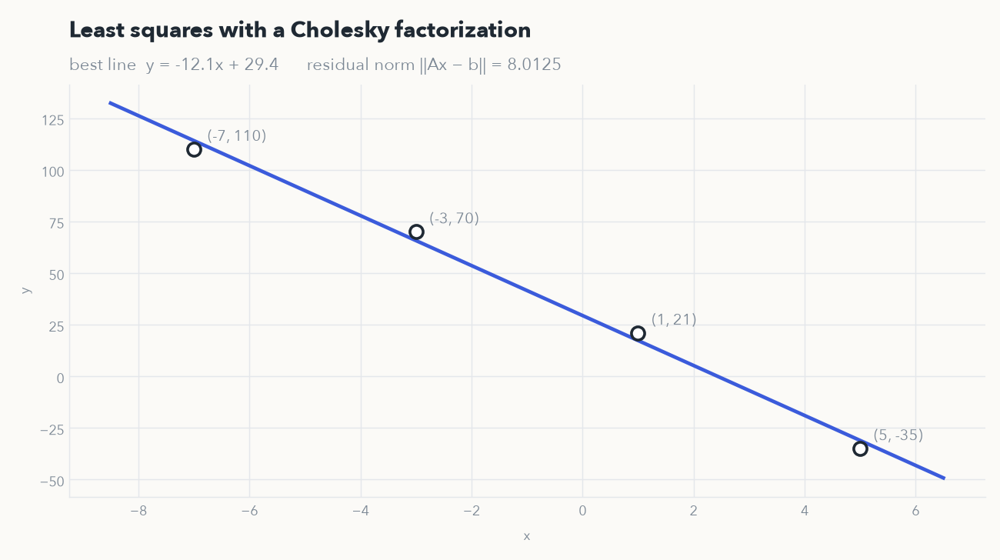
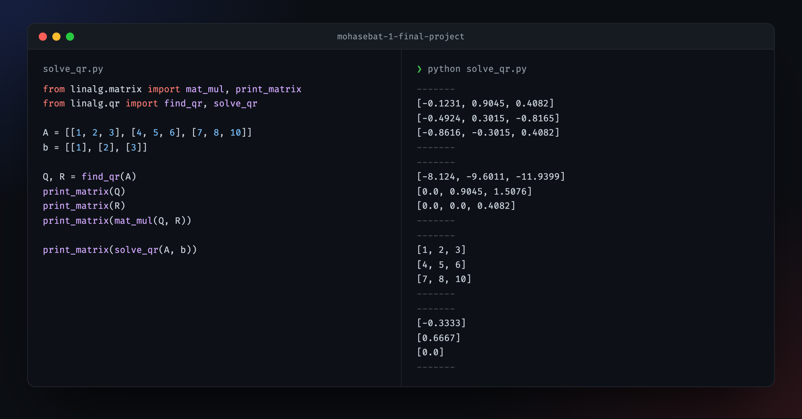

<div align="center">

# Scientific Computing 1 · Final Project

**Least squares and QR decomposition, written from scratch in plain Python.**<br>
Spring 2024

<br>



</div>

<br>

No numpy: every matrix operation, from multiplication to the factorizations, is written by hand on nested lists. The results match numpy's to the last printed digit.

## Least squares, through Cholesky

[`least_squares.py`](least_squares.py) finds the line that best fits four points. It forms the normal equations AᵀA x = Aᵀb, factors AᵀA as RᵀR with a Cholesky decomposition, then solves two triangular systems, Rᵀy = Aᵀb forward and Rx = y backward. It prints the coefficients, the error vector Ax − b and its norm.

## Solving Ax = b with Householder QR

[`solve_qr.py`](solve_qr.py) factors a 3 × 3 matrix as A = QR, building Q from Householder reflections that zero out one column at a time below the diagonal, then solves Rx = Qᵀb by back substitution.



<sub>Output rounded to four decimals for display.</sub>

## Layout

```
linalg/
  matrix.py        multiply, subtract, transpose, norms, identity
  triangular.py    forward and back substitution
  cholesky.py      the Cholesky factor R of a symmetric positive-definite matrix
  qr.py            Householder reflections and QR
least_squares.py   part A
solve_qr.py        part B
```

## Running it

Python 3.9 or newer, with nothing to install:

```bash
python least_squares.py
python solve_qr.py
```
